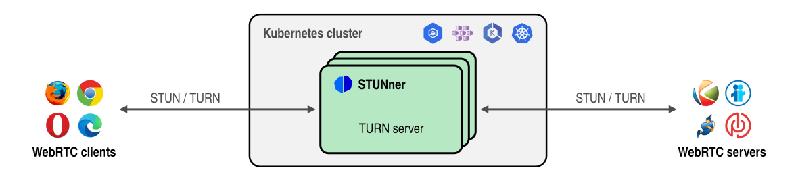
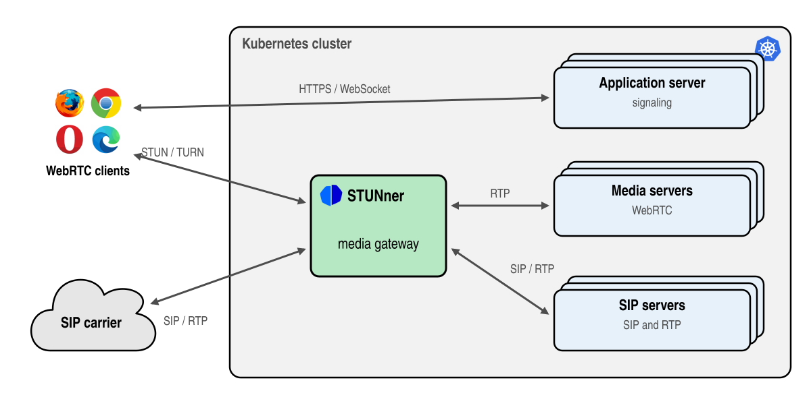
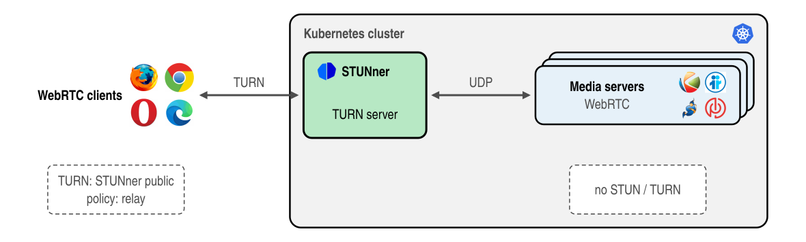
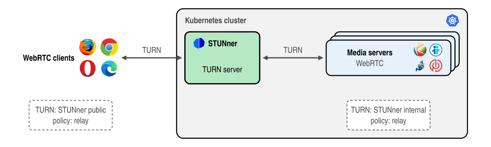
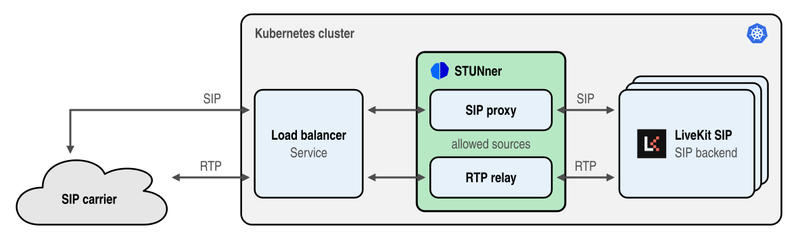
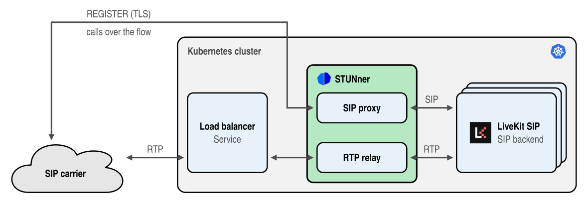
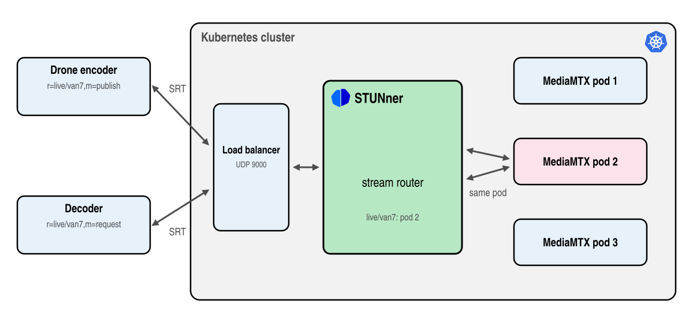
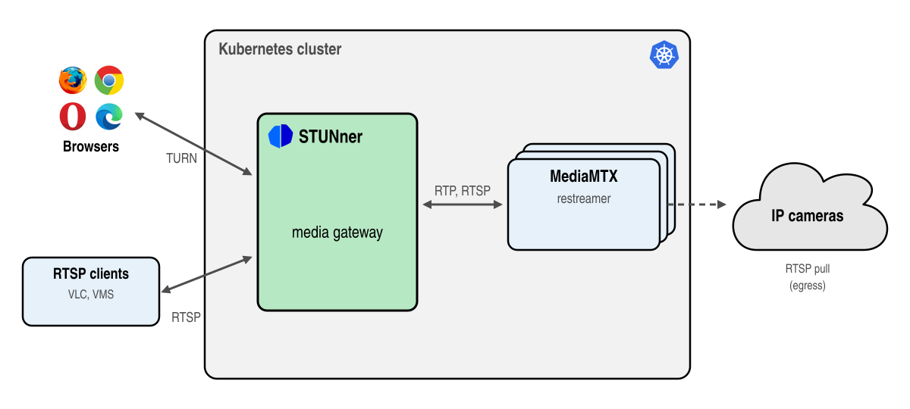

# Deployment models

STUNner can be deployed in many different ways, supporting a wide range of operational
requirements. For WebRTC, STUNner supports multiple [architectural models](#architectural-models)
where it acts either as a simple headless STUN/TURN server or as a fully fledged ingress gateway in
front of an entire Kubernetes-based media server pool. If STUNner is configured as an ingress
gateway then it can run in one of two [ICE models](#ice-models), based on whether only the client
connects via STUNner or both clients and media servers use STUNner to set up the media-plane
connection. For SIP and RTP, STUNner is the gateway between a carrier's SIP trunk and the SIP
servers in the cluster, in one of two [SIP deployment models](#sip-deployment-models) that follow
how the carrier authenticates the trunk. For live video, STUNner routes SRT streams to a pool of
media servers in the [SRT deployment model](#srt-deployment-model), and lets viewers watch IP
cameras through a restreamer in the cluster in the [RTSP deployment model](#rtsp-deployment-model).

## Architectural models

STUNner supports two architectural models, depending on whether it is used as a simple STUN/TURN
service for real-time media or it is functioning as an actual ingress gateway service to feed
traffic into a media server pool deployed *behind* STUNner.

### Headless deployment model

In the *headless deployment model* STUNner acts as a simple scalable STUN/TURN server that can be
used for real-time media clients and servers as a NAT traversal facility for establishing media
connections between themselves. This is not that much different from a standard public STUN/TURN
server setup, but in this case the STUN/TURN servers are deployed into Kubernetes.

<!-- > **Warning**   -->
<!-- For STUNner to be able to connect WebRTC clients and servers in the headless model *all* the -->
<!-- clients and servers *must* use STUNner as the TURN server. This is because STUNner opens the -->
<!-- transport relay connections *inside* the cluster, on a private IP address, and this address is -->
<!-- reachable only to STUNner itself, but not for external STUN/TURN servers. -->

### Media-plane deployment model

In the fully fledged *media-plane deployment model*, STUNner implements an ingress gateway service
that real-time media clients can use to open a relay connection to the media servers running
*inside* the Kubernetes cluster. This makes it possible to deploy WebRTC and SIP/VoIP services into
ordinary Kubernetes pods, taking advantage of Kubernetes's excellent tooling to manage, scale,
monitor and troubleshoot media services like any other cloud-bound workload.

<!-- This model provides theoretically limitless scalability. Furthermore, by creating -->
<!-- connection-tracking state for each client session STUNner supports the dynamic scale-out of the -->
<!-- media server pool without dropping active client connections. Whether scaling STUNner itself causes -->
<!-- client connection drops depend on the cloud provider's load-balancer service: if the load-balancer -->
<!-- creates conntrack state for clients' UDP transport streams then STUNner can be scaled freely, -->
<!-- otherwise scaling STUNner may result the [disconnection of a small number of client -->
<!-- connections](https://cilium.io/blog/2020/11/10/cilium-19/#maglev). -->

## WebRTC ICE models

WebRTC services rely on the Interactive Connectivity Establishment (ICE) framework to establish
direct peer-to-peer communication between browsers or devices, even when they are behind firewalls
or Network Address Translation (NAT) routers. STUNner offers two major modes for creating a working
ICE association.

### Asymmetric ICE mode

In *asymmetric ICE mode*, one peer is configured with STUNner as the TURN server and the other peer
runs with no STUN or TURN servers whatsoever. The first peer will create a TURN transport relay
connection via STUNner to which the other peer can directly join. Asymmetric ICE mode is the
recommended way for the media-plane deployment model for deploying WebRTC services. 

In this model, the client is configured with STUNner as the TURN server so at a certain point in
the ICE conversation it opens a TURN transport relay connection via STUNner. The IP address of the
resultant ICE [relay
candidate](https://developer.mozilla.org/en-US/docs/Web/API/RTCIceCandidate/type) is a private pod
IP address, namely the IP address of the `stunnerd` pod that happens to receive the client
connection. In contrast, servers run without any STUN/TURN server whatsoever, so they generate
[host ICE candidates](https://developer.mozilla.org/en-US/docs/Web/API/RTCIceCandidate/type)
only. Due to servers being deployed into ordinary Kubernetes pods, the server's host candidate will
likewise contain a private pod IP address. Then, since in the Kubernetes networking model ["pods
can communicate with all other pods on any other node without a
NAT"](https://kubernetes.io/docs/concepts/services-networking), the client's relay candidate and
the server's host candidate will have direct connectivity in the Kubernetes private container
network and the ICE connectivity check will succeed. See more explanation
[here](examples/kurento-one2one-call/README.md#what-is-going-on-here).

Refrain from configuring additional public STUN/TURN servers apart from STUNner itself. The rules
to follow for setting the [ICE server
configuration](https://github.com/l7mp/stunner#configuring-webrtc-clients) in asymmetric ICE mode
are as below:
- on the client, set STUNner as the *only* TURN server and configure *no* STUN servers, and
- on the server do *not* configure *any* STUN or TURN server whatsoever.

Deviating from these rules *might* work in certain cases, but may have uncanny and hard-to-debug
side-effects. For instance, configuring clients and servers with public STUN servers in certain
unlucky situations may allow them to connect via server-reflexive ICE candidates, completely
circumventing STUNner. This is on the one hand extremely fragile and, on the other hand, a security
vulnerability; remember, STUNner should be the *only* external access point to your media plane. It
is a good advice to set the `iceTransportPolicy` to `relay` on the clients to avoid side-effects:
this will prevent clients from generating host and server-reflexive ICE candidates, leaving STUNner
as the only option to obtain an ICE candidate from.

### Symmetric ICE mode

In the symmetric ICE mode both the client and the server obtain an ICE [relay
candidate](https://developer.mozilla.org/en-US/docs/Web/API/RTCIceCandidate/type) from STUNner and
the connection occurs directly via STUNner. This is the simplest mode for the headless deployment
model, but symmetric mode can also be used for the media-plane model as well to connect clients to
media servers.

In the symmetric mode the following rules apply for setting the [ICE server
configuration](https://github.com/l7mp/stunner#configuring-webrtc-clients):

- on both the clients and the server set STUNner as the *only* TURN server and configure *no* STUN
  servers, and
- set the `iceTransportPolicy` to `relay` on both sides.

The `iceTransportPolicy: relay` setting is mandatory in this case, otherwise the connection falls
back to the asymmetric mode (this is a consequence of the way [ICE assigns
priorities](https://www.ietf.org/rfc/rfc5245.txt) to different connection types).  Furthermore, it
is a good practice to configure the STUNner TURN URI in the server-side ICE server configuration
with the *internal* IP address and port used by STUNner (i.e., the ClusterIP of the `stunner`
Kubernetes service and the corresponding port), otherwise the server might connect via the external
LoadBalancer IP causing an unnecessary roundtrip (hairpinning).

The symmetric mode means more overhead compared to the asymmetric mode, since STUNner now performs
TURN encapsulation/decapsulation for both sides. However, the symmetric mode comes with certain
operational advantages. Namely, this is the only ICE mode that would allow STUNner to obscure the
internal IP addresses in the ICE candidates from attackers; note that this is not implemented yet,
but feel free to open an issue if [exposing internal IP addresses](SECURITY.md) is blocking
you from adopting STUNner.

## SIP deployment models

> [!WARNING]
> The SIP gateway is in beta: the API may change in any release and there is no support on any tier.
> Please test and report issues, but in any way, use it at your own risk.

A SIP trunk connects a carrier, owning the phone numbers and the connection to the public phone
network, to your Kubernetes-bound SIP server pool. STUNner sits between the two as a gateway: it
proxies the SIP signaling to the SIP servers running in the cluster and relays RTP media between
the carrier and the SIP servers. This allows SIP/RTP servers to run without a public address and a
public RTP port range. STUNner supports two kinds of carrier trunks.

In both models the carrier sends the media of a call to the public media port of the Gateway, and
STUNner matches packets to calls by the source IP address. This requires a load balancer that
preserves the carriers' source addresses: most Kubernetes load-balancer integrations provide
excellent support for this mode (`externalTrafficPolicy: Local` on the Gateway's Service).

### IP-authenticated SIP trunk

In an *IP-authenticated trunk* (also called a static or peering trunk, as sold by CPaaS providers
like Twilio, Telnyx or Bandwidth), the carrier sends the calls to a dedicated public SIP address
from a known set of signaling addresses. STUNner exposes the SIP listeners of the Gateway on a
public address, admits calls only from the carrier's address ranges, and forwards signaling traffic
to the SIP servers behind it.

### Registration-based SIP trunk

In a *registration-based trunk* (the SIP account of most SMB and ISP carriers), the carrier expects
your side to register with the registrar and delivers the calls to the registered contact. STUNner
can dial the registrar itself, preferably over TLS, registers the number with the trunk's
credentials, and takes the inbound calls over the same connection: the carrier needs no route to
the cluster for signaling, and the egress address of the cluster does not matter.

## SRT deployment model

> [!WARNING]
> The SRT gateway is in beta: the API may change in any release and there is no support on any tier.
> Please test and report issues, but in any way, use it at your own risk.

SRT carries live video from the field to the studio or the cloud: an encoder, a drone or a camera
publishes its stream, decoders and players read it, all through a media server in between. STUNner
exposes one public UDP port for every SRT caller and routes every connection to the media server
pod that holds its stream, by the stream ID of the SRT handshake: the publisher and the readers of
a stream meet on the same pod, however many replicas run behind the Gateway. The encryption of
the streams stays end to end between the callers and the media servers. See the [SRT gateway
guide](SRT.md).

## RTSP deployment model

> [!WARNING]
> RTSP streaming through STUNner is in beta: the deployment model may change in any release, there
> is no support on any tier, and only RTSP interleaved over TCP is supported. Please test and report
> issues, but in any way, use it at your own risk.

IP cameras are RTSP servers that answer whoever pulls them, so a restreamer in the cluster (e.g.,
MediaMTX) pulls every camera over its own outgoing connection, and the viewers watch what the
restreamer re-serves: browsers over WebRTC with STUNner as the TURN server, RTSP clients over a
plain TCP listener of STUNner. See the [RTSP streaming guide](RTSP.md).

