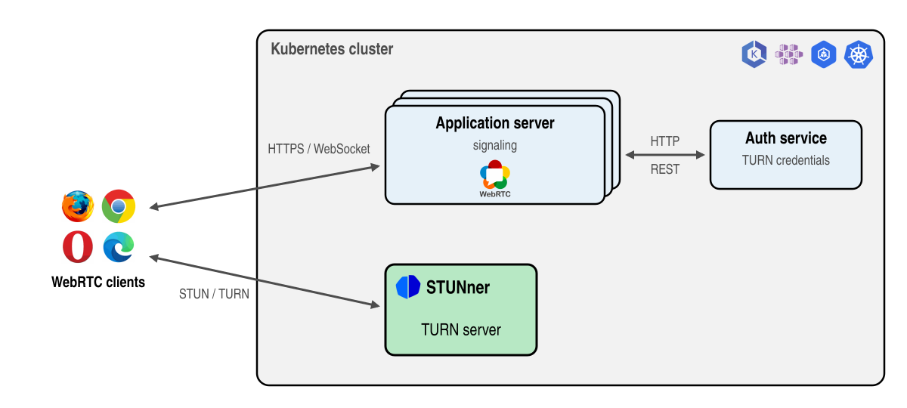
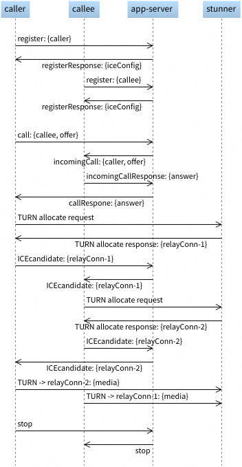

# Direct one to one video call via STUNner

> [!WARNING]
> Certain features require premium support: see [here](https://l7mp.io/pricing) for the limits and
> pricing.

This tutorial shows the *headless deployment model* of STUNner: two WebRTC clients call each other
directly, through STUNner as their TURN server, with no media server in between. A small Node.js
application server in Kubernetes serves the web page of the call and relays the signaling between
the two browsers; the audio and the video flow between the browsers through STUNner.



In this tutorial you will learn how to:
* configure STUNner as a headless TURN server,
* generate the ICE configuration of the clients with the STUNner authentication service,
* integrate a WebRTC application server with STUNner,
* make a video call from your browser through STUNner.

## Prerequisites

* A STUNner installation, see the [installation guide](../../INSTALL.md).
* A WebRTC browser, any modern one.

## The application server

The application server registers the two parties of a call, and relays the SDP offer and answer
and the ICE candidates between them over a WebSocket. Each browser needs an ICE configuration with
the public address of STUNner and the TURN credentials before it creates its PeerConnection, so the
server hands each client one when the client registers:



The [STUNner authentication service](https://github.com/l7mp/stunner-auth-service), installed with
STUNner, generates the ICE configurations from the running STUNner configuration, so the
application never hard-codes an address or a credential. The application server finds it at
`stunner-auth.stunner-system.svc.cluster.local:8088`, set in its Deployment:

```yaml
env:
  - name: STUNNER_AUTH_ADDR
    value: "stunner-auth.stunner-system.svc.cluster.local"
  - name: STUNNER_AUTH_PORT
    value: "8088"
```

and asks for an ICE configuration whenever a client registers, which it then returns to the client
in the `registerResponse` message:

```js
let options = {
  host: process.env.STUNNER_AUTH_ADDR,
  port: process.env.STUNNER_AUTH_PORT,
  method: 'GET',
  path: url.format({
    pathname: '/ice',
    query: { service: "turn", username: name, iceTransportPolicy: "relay" },
  }),
};
```

The client passes the ICE configuration to every PeerConnection it creates. The full code is in the
[tutorial repo](https://github.com/l7mp/kurento-tutorial-node/tree/master/direct-one2one-call).

## Configuration

1. Deploy the application server: the manifest runs the prebuilt image in the current namespace
   and exposes it on HTTPS port 8443 with a LoadBalancer Service called `webrtc-server`.

   ```console
   cd stunner
   kubectl apply -f docs/examples/direct-one2one-call/direct-one2one-call-server.yaml
   ```

1. Configure STUNner: the manifest creates the GatewayClass and the GatewayConfig of the other
   tutorials, a TURN Gateway on UDP port 3478 and another one on TCP port 3478, and a UDPRoute.

   ```console
   kubectl create namespace stunner
   kubectl apply -f docs/examples/direct-one2one-call/direct-one2one-call-stunner.yaml
   ```

   In the headless model the clients reach each other through the relays STUNner opens for them,
   so STUNner must route the clients back to itself: the UDPRoute names the Services of the two
   Gateways as its backends, so two clients reach each other whichever Gateway and whichever
   STUNner pod they use.

   ```yaml
   apiVersion: stunner.l7mp.io/v1
   kind: UDPRoute
   metadata:
     name: stunner-headless
     namespace: stunner
   spec:
     parentRefs:
       - name: udp-gateway
       - name: tcp-gateway
     rules:
       - backendRefs:
           - name: udp-gateway
             namespace: stunner
           - name: tcp-gateway
             namespace: stunner
   ```

1. Check that the Gateways are programmed and have a public address:

   ```console
   kubectl -n stunner get gateways
   ```

## Test

Learn the address of the application server:

```console
export WEBRTC_SERVER_IP=$(kubectl get service webrtc-server -o jsonpath='{.status.loadBalancer.ingress[0].ip}')
echo https://${WEBRTC_SERVER_IP}:8443
```

Open the URL in your browser and accept its self-signed certificate. Register a user name, then
open the URL in another browser window and register another one. Call one from the other, accept
the call, and enjoy a video call with yourself, through STUNner.

The console of the page shows the call setup:

* The `registerResponse` carries the ICE configuration from the authentication service: a TURN URI
  per Gateway with the public addresses of STUNner and the credentials, and the `relay` ICE
  transport policy, so the browser uses STUNner only.
* The browser then opens TURN relays on STUNner and sends their addresses to the other party as its
  ICE candidates, `typ relay` with the private address of the STUNner pod that opened the relay.
* The other browser does the same, and the media flows between the two relays inside STUNner. The
  browsers can sit behind any NAT: they only ever talk to STUNner.

## Troubleshooting

* **The page does not load.** Check that the `webrtc-server` Service has an external address and
  that TCP port 8443 is reachable from your browser.
* **No ICE candidate appears.** Compare the ICE configuration in the `registerResponse` with
  `stunnerctl -n stunner config udp-gateway`, and look for permission errors in the STUNner logs:
  `kubectl -n stunner logs deploy/udp-gateway`.
* **No audio or video.** UDP may be blocked on the way: the TCP Gateway offers the browsers TURN over
  TCP as well. The [TURN troubleshooting guide](https://www.giacomovacca.com/2022/05/troubleshooting-turn.html)
  helps to track down the rest.

## Relay address discovery (premium tiers)

The relays above sit on the private addresses of the STUNner pods, which is fine as long as both
parties of a call use STUNner. A party that does not, say a mobile app with a TURN server of its own,
cannot reach a private relay address, and the call fails. With a STUNner license, [relay address
discovery](../../PREMIUM_REFERENCE.md#relay-address-discovery) puts the public address of the node
into the relay candidates instead, which makes STUNner a public TURN server that any party can
reach. It runs the dataplane on the nodes' network (a [DaemonSet
dataplane](../../PREMIUM_REFERENCE.md#deploying-into-a-daemonset) with `hostNetwork: true`), on
nodes that have a public address, and is switched on per Gateway:

```console
kubectl -n stunner annotate --overwrite gateway udp-gateway stunner.l7mp.io/enable-relay-address-discovery=true
```

Register and call again: the relay candidates in the console now carry the public address of the
node. See the [pricing](https://l7mp.io/pricing) for the license tiers and the [premium installation
guide](../../PREMIUM_INSTALL.md) for setting up STUNner with a license.

## Clean up

Remove everything the tutorial created:

```console
kubectl delete -f docs/examples/direct-one2one-call/direct-one2one-call-server.yaml
kubectl delete -f docs/examples/direct-one2one-call/direct-one2one-call-stunner.yaml
kubectl delete namespace stunner
```

The dataplane shuts down gracefully, serving its live TURN sessions to the end, so deleting the
namespace may take a while: a session whose browser went away without releasing it ends when it
times out, within ten minutes.
