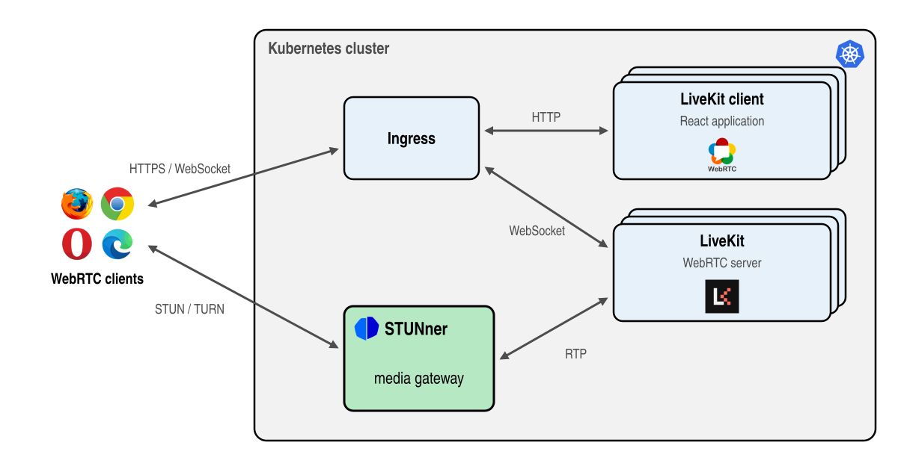

# Video-conferencing with LiveKit

> [!WARNING]
> Certain features require premium support: see [here](https://l7mp.io/pricing) for the limits and
> pricing.

This document guides you through the installation of [LiveKit](https://livekit.io/) into Kubernetes, when it is used together with the STUNner WebRTC media gateway.

In this tutorial you will learn how to:

- integrate a typical WebRTC application with STUNner,
- obtain a valid TLS certificate to secure the signaling plane,
- deploy the LiveKit server into Kubernetes, and
- configure STUNner to expose LiveKit to clients.

## Prerequisites

To run this example, you need:

- a [Kubernetes cluster](../../INSTALL.md#prerequisites),
- a [deployed STUNner](../../INSTALL.md#installation-1) (presumably the latest stable version),
- an [Ingress controller](../TLS.md#ingress) to ingest traffic into the cluster,
- a [Cert-manager](../TLS.md#cert-manager) to automate TLS certificate management.

> [!NOTE]
>
> If you have your own TLS certificate, put it in a `Secret` [resource](https://kubernetes.io/docs/concepts/configuration/secret/) and deploy it into the `default` namespace under the `livekit-secret-tls` name.

The [TLS guide](../TLS.md) installs the Ingress controller and cert-manager, and exports the
address of the Ingress in the `INGRESS_IP` variable the commands below use.

The commands fill the addresses into the manifests with `envsubst` from GNU gettext, installed on
most Linux systems (`gettext-base` on Debian and Ubuntu, `gettext` on macOS with Homebrew).

## Description

The recommended way to install LiveKit into Kubernetes is deploying the media servers into the host-network namespace of the Kubernetes nodes (`hostNetwork: true`). This deployment model, however, comes with a set of uncanny [operational limitations and security concerns](../../WHY.md). Using STUNner, media servers can be deployed into ordinary Kubernetes pods and run over a private IP network, like any "normal" Kubernetes workload.

The figure below shows LiveKit deployed into regular Kubernetes pods behind STUNner without the host-networking hack. Here, LiveKit is deployed behind STUNner in the [*media-plane deployment model*](../../DEPLOYMENT.md), so that STUNner acts as a "local" STUN/TURN server for LiveKit, saving the overhead of using a public 3rd party STUN/TURN server for NAT traversal.



In this tutorial we deploy the [LiveKit server](https://github.com/livekit/livekit) for media exchange, a Kubernetes Ingress gateway to secure signaling connections and handle TLS, and STUNner as a media gateway to expose the LiveKit server pool to clients.


### STUNner

Now comes the fun part. The simplest way to run this demo is to clone the [STUNner git repository](https://github.com/l7mp/stunner) and deploy the manifests packaged with STUNner.

Configure STUNner to act as a STUN/TURN server to clients, and route all received media to the LiveKit server pods.

```console
git clone https://github.com/l7mp/stunner
cd stunner
kubectl create namespace stunner
kubectl apply -f docs/examples/livekit/livekit-call-stunner.yaml
```

The relevant parts here are the STUNner [Gateway definition](../../GATEWAY.md#gateway), which exposes the STUNner STUN/TURN server over UDP:3478 to the Internet, and the [UDPRoute definition](../../ROUTE.md#udproute), which takes care of routing media to the pods running the LiveKit service.

```yaml
apiVersion: gateway.networking.k8s.io/v1
kind: Gateway
metadata:
  name: udp-gateway
  namespace: stunner
spec:
  gatewayClassName: stunner-gatewayclass
  listeners:
    - name: udp-listener
      port: 3478
      protocol: TURN-UDP
---
apiVersion: stunner.l7mp.io/v1
kind: UDPRoute
metadata:
  name: livekit-media-plane
  namespace: stunner
spec:
  parentRefs:
    - name: udp-gateway
  rules:
    - backendRefs:
        - name: livekit-server
          namespace: default
```

Once the Gateway resource is installed into Kubernetes, STUNner will create a Kubernetes LoadBalancer for the Gateway to expose the TURN server on UDP:3478 to clients. It can take up to a minute for Kubernetes to allocate a public external IP for the service.

Wait until Kubernetes assigns an external IP and store the external IP assigned by Kubernetes to
STUNner in an environment variable for later use.

```console
until [ -n "$(kubectl get svc udp-gateway -n stunner -o jsonpath='{.status.loadBalancer.ingress[0].ip}')" ]; do sleep 1; done
export STUNNER_IP=$(kubectl get service udp-gateway -n stunner -o jsonpath='{.status.loadBalancer.ingress[0].ip}')
```

### LiveKit

The crucial step of integrating *any* WebRTC media server with STUNner is to ensure that the server instructs the clients to use STUNner as the STUN/TURN server. To this end, the LiveKit deployment manifest names the public address of STUNner with the placeholder `${STUNNER_IP}`, which we fill in with the address learned above when we apply the manifest.

Assuming that Kubernetes assigns the IP address 1.2.3.4 to STUNner (i.e., `STUNNER_IP=1.2.3.4`), the relevant part of the LiveKit config would be something like the below:

```yaml
...
rtc:
  ...
  turn_servers:
  - host: 1.2.3.4
    username: user-1
    credential: pass-1
    protocol: udp
    port: 3478
```

This will make sure that LiveKit is started with STUNner as the STUN/TURN server. If unsure about the STUNner settings to use, you can always use the handy [`stunnerctl` CLI tool](/docs/cmd/stunnerctl.md) to dump the running STUNner configuration.

``` console
stunnerctl -n stunner config udp-gateway
Gateway: stunner/udp-gateway (loglevel: "all:INFO")
Authentication default: static, username/password: user-1/pass-1
Listeners:
  - Name: stunner/udp-gateway/udp-listener
    Protocol: UDP
    Server: stunner/udp-gateway/udp-listener (TURN)
    Address:port: <none>:3478
    Public address:port: 34.118.88.91:3478
    Clusters: [stunner/livekit-media-plane/udp]
    Endpoints: [10.76.1.4, 10.80.4.47]
```

Note that LiveKit itself will not use STUNner (that would amount to a less efficient [symmetric ICE mode](../../DEPLOYMENT.md)); with the above configuration we are just telling LiveKit to instruct its clients to use STUNner to reach the LiveKit media servers.

Likewise, the placeholder `${INGRESS_IP}` takes the address of the Ingress, so that cert-manager issues the TLS certificate for the right `nip.io` domain.

Finally, fire up LiveKit.

```console
envsubst '$STUNNER_IP $INGRESS_IP' < docs/examples/livekit/livekit-server.yaml > livekit-server.yaml
kubectl apply -f livekit-server.yaml
```

The demo installation bundle includes a lot of resources to deploy LiveKit:

- a LiveKit server, with a Redis instance for its room state,
- a cluster issuer for the TLS certificates,
- an Ingress resource to terminate the secure connections between your browser and the Kubernetes cluster.

Wait until all pods become operational and jump right into testing!

## Test

Join a room from [LiveKit Meet](https://meet.livekit.io/?tab=custom), the browser client LiveKit
hosts, which connects to any LiveKit server. It needs the address of your LiveKit server, which the
Ingress exposes:

```console
echo wss://mediaserver-$INGRESS_IP.nip.io
```

and an access token, which the [LiveKit CLI](https://docs.livekit.io/home/cli/), `lk`, signs with
the API key and secret of the LiveKit configuration:

```console
lk token create --api-key access_token --api-secret secretsecretsecretsecretsecretsecret \
    --join --room room --identity user1 --valid-for 24h
```

On the Custom tab of LiveKit Meet, enter the server address and the token and connect. Repeat it in
another browser tab with another identity (`--identity user2`), and enjoy a video conference with
yourself: all the media between the tabs flows through STUNner and the LiveKit server in your
cluster.

## High-availability operator (premium tiers)

The STUNner gateway operator serves the configuration of every dataplane, and sooner or later it
restarts: its node is drained, the cluster is upgraded, a new version is rolled out. A restarted
operator rolls the dataplane pods, which disconnects every client of every LiveKit room:

```console
kubectl -n stunner-system rollout restart deployment/stunner-gateway-operator-controller-manager
kubectl -n stunner get pods
```

With a STUNner license the [high-availability operator](../../PREMIUM_REFERENCE.md#high-availability-operator)
takes over the running dataplane pods instead: restart the operator again, and the dataplane pods
and the calls in the rooms stay as they are. Run two operator replicas with leader election for a
hot standby that takes over at once. See the [pricing](https://l7mp.io/pricing) for the license tiers and the [premium installation
guide](../../PREMIUM_INSTALL.md) for setting up STUNner with a license.

## Clean up

Remove everything the tutorial created:

```console
kubectl delete -f livekit-server.yaml
kubectl delete -f docs/examples/livekit/livekit-call-stunner.yaml
kubectl delete namespace stunner
rm livekit-server.yaml
```
