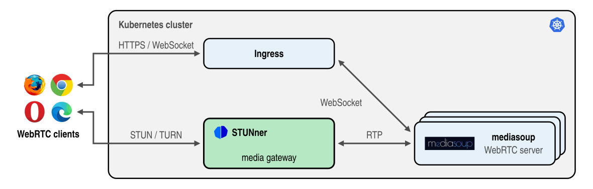

# STUNner Tutorial: Video-conferencing with mediasoup

This document guides you through the installation of [mediasoup](https://mediasoup.org/) into Kubernetes, when it is used together with the STUNner WebRTC media gateway.

In this tutorial you will learn how to:

- integrate a typical WebRTC application with STUNner,
- obtain a valid TLS certificate to secure the signaling plane,
- deploy the mediasoup server into Kubernetes, and
- configure STUNner to expose mediasoup to clients.

## Prerequisites

To run this example, you need:

- a [Kubernetes cluster](../../INSTALL.md#prerequisites),
- a [deployed STUNner](../../INSTALL.md#installation-1) (presumably the latest stable version),
- an [Ingress controller](../TLS.md#ingress) to ingest traffic into the cluster,
- a [Cert-manager](../TLS.md#cert-manager) to automate TLS certificate management.

> [!NOTE]
>
> If you have your own TLS certificate, put it in a `Secret` [resource](https://kubernetes.io/docs/concepts/configuration/secret/) and deploy it into the `mediasoup` namespace under the `mediasoup-demo-tls` name.

The [TLS guide](../TLS.md) installs the Ingress controller and cert-manager, and exports the
address of the Ingress in the `INGRESS_IP` variable the commands below use.

The commands fill the addresses into the manifests with `envsubst` from GNU gettext, installed on
most Linux systems (`gettext-base` on Debian and Ubuntu, `gettext` on macOS with Homebrew).

## Description

The recommended way to install mediasoup ([link](https://mediasoup.discourse.group/t/server-in-kubernetes-with-turn/3434),[link](https://www.reddit.com/r/kubernetes/comments/sdkhwn/deploying_mediasoup_webrtc_sfu_in_kubernetes/)) into Kubernetes is deploying the media servers into the host-network namespace of the Kubernetes nodes (`hostNetwork: true`). This deployment model, however, comes with a set of uncanny [operational limitations and security concerns](../../WHY.md). Using STUNner, media servers can be deployed into ordinary Kubernetes pods and run over a private IP network, like any "normal" Kubernetes workload.

The figure below shows mediasoup deployed into regular Kubernetes pods behind STUNner without the host-networking hack. Here, mediasoup is deployed behind STUNner in the [*media-plane deployment model*](../../DEPLOYMENT.md), so that STUNner acts as a "local" STUN/TURN server for mediasoup, saving the overhead of using a public 3rd party STUN/TURN server for NAT traversal.



In this tutorial we deploy a video room example using [mediasoup's demo application](https://github.com/versatica/mediasoup-demo/) with slight modifications (more on these below), the [mediasoup server](https://github.com/versatica/mediasoup/) for media exchange, a Kubernetes Ingress gateway to secure signaling connections and handle TLS, and STUNner as a media gateway to expose the mediasoup server pool to clients.

### Modifications on the mediasoup demo

Below are the modifications made starting from [mediasoup-demo](https://github.com/versatica/mediasoup-demo/):

- Added a multistage Dockerfile

  - stage 0: run gulp dist to create the frontend app files (they will be served by nodejs from the backend)
  - stage 1: build the image for the mediasoup-server and copy the mediasoup-client file

- Added a simple script that gathers the internal/private IP of the running pod, this is not foolproof, however,
with an additional environment variable we can load the pod's private IP into the code

- Added the following in server.js in the function "async function createExpressApp()" to serve the mediasoup-client file

```text
147:	expressApp.use(express.static('public'))
```

- Added the parsing of url parameters to configure TURN server and a simple if/else in server/app/lib/RoomClient.js. The mediasoup clients will use the configured TURN server to gather the ICE candidates. Example: https://mediasoup-demo.example.com/?enableIceServer=yes&iceServerHost=100.100.100.100&iceServerPort=3478&iceServerProto=udp&iceServerUser=user-1&iceServerPass=pass-1

### STUNner

Now comes the fun part. The simplest way to run this demo is to clone the [STUNner git repository](https://github.com/l7mp/stunner) and deploy the manifests packaged with STUNner.

To install the stable version of STUNner, please follow the instructions in [this section](../../INSTALL.md#installation-1).

Configure STUNner to act as a STUN/TURN server to clients, and route all received media to the mediasoup server pods.

```console
git clone https://github.com/l7mp/stunner
cd stunner
kubectl create namespace stunner
kubectl apply -f docs/examples/mediasoup/mediasoup-call-stunner.yaml
```

The relevant parts here are the STUNner [Gateway definition](../../GATEWAY.md#gateway), which exposes the STUNner STUN/TURN server over UDP:3478 to the Internet, and the [UDPRoute definition](../../ROUTE.md#udproute), which takes care of routing media to the pods running behind the `mediasoup-server` service.

```yaml
apiVersion: gateway.networking.k8s.io/v1
kind: Gateway
metadata:
  name: udp-gateway
  namespace: stunner
spec:
  gatewayClassName: stunner-gatewayclass
  listeners:
    - name: udp-listener
      port: 3478
      protocol: TURN-UDP
---
apiVersion: stunner.l7mp.io/v1
kind: UDPRoute
metadata:
  name: mediasoup-media-plane
  namespace: stunner
spec:
  parentRefs:
    - name: udp-gateway
  rules:
    - backendRefs:
      - group: ""
        kind: Service
        name: mediasoup-server
        namespace: mediasoup
```

Once the Gateway resource is installed into Kubernetes, STUNner will create a Kubernetes LoadBalancer for the Gateway to expose the TURN server on UDP:3478 to clients. It can take up to a minute for Kubernetes to allocate a public external IP for the service.

Wait until Kubernetes assigns an external IP and store the external IP assigned by Kubernetes to
STUNner in an environment variable for later use.

```console
until [ -n "$(kubectl get svc udp-gateway -n stunner -o jsonpath='{.status.loadBalancer.ingress[0].ip}')" ]; do sleep 1; done
export STUNNER_IP=$(kubectl get service udp-gateway -n stunner -o jsonpath='{.status.loadBalancer.ingress[0].ip}')
```

### mediasoup

The crucial step of integrating *any* WebRTC media server with STUNner is to ensure that the server instructs the clients to use STUNner as the STUN/TURN server. However, there is a slight issue. In this deployment it's not the server that instructs the clients to use STUNner but the user. Obviously, it is not the optimal way but for the sake of the demo we keep it that way. In case anyone would want to create a production ready deployment, they would need to add extra capabilities to the mediasoup server:
- first to make sure turn servers can be configured in the server's config.js file
- second to make sure that clients can fetch (or get automatically) the configured turn servers from the mediasoup server

The manifest names the address of the Ingress with the placeholder `${INGRESS_IP}`, so that cert-manager issues the TLS certificate for the right `nip.io` domain.

Finally, fire up mediasoup.

```console
kubectl create ns mediasoup
envsubst '$INGRESS_IP' < docs/examples/mediasoup/mediasoup-server.yaml > mediasoup-server.yaml
kubectl apply -f mediasoup-server.yaml
```

The demo installation bundle includes a lot of resources to deploy mediasoup:

- a mediasoup-server,
- an application server serving the landing page using [mediasoup-demo](https://github.com/versatica/mediasoup-demo/)
- a cluster issuer for the TLS certificates,
- an Ingress resource to terminate the secure connections between your browser and the Kubernetes cluster.

Wait until all pods become operational and jump right into testing!

## Test

After installing everything, execute the following command to retrieve the URL of your fresh mediasoup demo app:

```console
echo "https://mediasoup-$INGRESS_IP.nip.io:443?enableIceServer=yes&iceServerHost=$STUNNER_IP&iceServerPort=3478&iceServerProto=udp&iceServerUser=user-1&iceServerPass=pass-1"
```

Opening the output in a browser should bring up the mediasoup client demo app.

In case you changed something additionally in the STUNner configuration during deployment watch out for the URL parameters:
  - `enableIceServer` must be `yes` in order to use STUNner as a TURN server
  - `iceServerHost` should point to the public IP that was allocated for the STUNner load balancer service
  - `iceServerPort` is the port of your TURN server configured in the Gateway resource
  - `iceServerProto` is the expected protocol on the port configured above
  - `iceServerUser` is the username used for authentication in STUNner
  - `iceServerPass` is the credential used for authentication in STUNner

## Acknowledgments

This demo is adopted from [damhau/mediasoup-demo-docker](https://github.com/damhau/mediasoup-demo-docker). Huge thanks to @damhau for the great demo!

## Going further: DaemonSet dataplane

A large conference draws clients to every node of the cluster, while a Deployment places the
STUNner pods wherever the scheduler likes: the load balancer takes an extra hop to reach them, and
a busy node may carry several. With a STUNner license, the [DaemonSet
dataplane](../../PREMIUM_REFERENCE.md#deploying-into-a-daemonset) runs one STUNner pod on every
node, which grows with the cluster and, with the `stunner.l7mp.io/external-traffic-policy: local`
Gateway annotation, serves every client from the node the load balancer sends it to:

```console
kubectl patch dataplane default --type merge -p '{"spec":{"dataplaneResource":"DaemonSet"}}'
kubectl -n stunner get daemonsets
```

See the [pricing](https://l7mp.io/pricing) for the license tiers and the [premium installation
guide](../../PREMIUM_INSTALL.md) for setting up STUNner with a license.

## Next steps

The [other media-plane tutorials](../../README.md) put further WebRTC media servers behind STUNner.

## Clean up

Remove everything the tutorial created:

```console
kubectl delete -f mediasoup-server.yaml
kubectl delete -f docs/examples/mediasoup/mediasoup-call-stunner.yaml
kubectl patch dataplane default --type merge -p '{"spec":{"dataplaneResource":"Deployment"}}'
kubectl delete namespace mediasoup stunner
rm mediasoup-server.yaml
```
