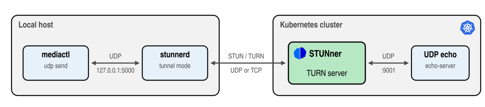

# Open a UDP tunnel via STUNner

> [!WARNING]
> Certain features require premium support: see [here](https://l7mp.io/pricing) for limits and
> pricing.

This tutorial tunnels a local UDP client through STUNner to a UDP echo service in the cluster, and
measures the loss and the round trip of the path, over TURN on UDP and on TCP and under load: a
quick way to evaluate the UDP and TCP stack of your cloud provider. A similar setup creates a
makeshift VPN into your cluster.



In this tutorial you will learn how to:
* expose a UDP service to clients over TURN on UDP and on TCP,
* open a local UDP tunnel into the cluster with the [tunnel mode of
  `stunnerd`](../../cmd/stunnerd.md#tunnel-mode),
* measure the path, also under load, with [`mediactl`](../../cmd/mediactl.md).

## Prerequisites

* A STUNner installation, see the [installation guide](../../INSTALL.md).
* The `stunnerd`, `stunnerctl` and `mediactl` tools: download them from the [STUNner
  releases](https://github.com/l7mp/stunner/releases) or install them with `go install
  github.com/l7mp/stunner/v2/cmd/<tool>@latest`.

## Configuration

1. Deploy the echo server: a Deployment running `mediactl udp echo` on UDP port 9001, behind the
   `echo-server` Service of type `ClusterIP` in the `default` namespace. The Service has no external
   address, so the only way in is through STUNner.

   ```console
   cd stunner
   kubectl apply -f docs/examples/simple-tunnel/echo-server.yaml
   ```

1. Expose the echo server through STUNner. The manifest creates the GatewayClass and the
   GatewayConfig of the other tutorials, a TURN Gateway on UDP port 3478 and another one on TCP port
   3478, and a UDPRoute that attaches to both and names the `echo-server` Service as its backend:

   ```console
   kubectl create namespace stunner
   kubectl apply -f docs/examples/simple-tunnel/tunnel-stunner.yaml
   ```

   ```yaml
   apiVersion: gateway.networking.k8s.io/v1
   kind: Gateway
   metadata:
     name: udp-gateway
     namespace: stunner
   spec:
     gatewayClassName: stunner-gatewayclass
     listeners:
       - name: udp-listener
         port: 3478
         protocol: TURN-UDP
   ---
   apiVersion: gateway.networking.k8s.io/v1
   kind: Gateway
   metadata:
     name: tcp-gateway
     namespace: stunner
   spec:
     gatewayClassName: stunner-gatewayclass
     listeners:
       - name: tcp-listener
         port: 3478
         protocol: TURN-TCP
   ---
   apiVersion: stunner.l7mp.io/v1
   kind: UDPRoute
   metadata:
     name: echo-server
     namespace: stunner
   spec:
     parentRefs:
       - name: udp-gateway
       - name: tcp-gateway
     rules:
       - backendRefs:
           - name: echo-server
             namespace: default
   ```

1. Check that both Gateways are programmed and have a public address (a cloud load balancer may
   take up to a minute to assign one):

   ```console
   kubectl -n stunner get gateways
   NAME          CLASS                  ADDRESS         PROGRAMMED   AGE
   tcp-gateway   stunner-gatewayclass   35.187.97.94    True         40s
   udp-gateway   stunner-gatewayclass   35.205.10.190   True         40s
   ```

   [`stunnerctl`](../../cmd/stunnerctl.md) shows the configuration STUNner runs for a Gateway:
   `stunnerctl -n stunner config udp-gateway`.

1. Check that the Gateways got a public address. It takes up to a minute for a cloud load balancer
   to assign one. Check the Services of the Gateways: `kubectl -n stunner get services`.


## Test

Open a tunnel that listens on the local UDP port 5000 and relays what it receives through the TURN
listener `udp-listener` to the echo server. `stunnerd` reads the address of the TURN server and the
credentials from the Gateway, and the address of the echo server from the Service, through your
kubeconfig: `k8s://default/echo-server:udp` is the first ready pod of the `echo-server` Service, at
the port of its Service port `udp`.

```console
stunnerd udp://127.0.0.1:5000 k8s://stunner/udp-gateway/udp-listener k8s://default/echo-server:udp
```

From another terminal, send packets through the tunnel for ten seconds and measure the echo. By
default `mediactl` sends 50 packets of 160 bytes a second, the 20 ms frames of a G.711 call:

```console
mediactl udp send -t 10s 127.0.0.1:5000
...
mediactl INFO: summary ..., lost 0/500 (0.00%), rtt min/avg/max 215µs/460µs/2.367ms, jitter 31µs
```

Every packet carries a sequence number and a timestamp, so `mediactl` reports the loss, the round
trip and the jitter of the whole path: the tunnel, STUNner and the echo server. Add `--max-loss` or
`--max-rtt` to fail above a threshold, or `-o json` for a machine-readable report. Stop the tunnel
and repeat the test over TURN on TCP:

```console
stunnerd udp://127.0.0.1:5000 k8s://stunner/tcp-gateway/tcp-listener k8s://default/echo-server:udp
```

TURN over TCP retransmits the lost packets and holds back everything behind them, which shows as a
growing round trip on a lossy path: that is why real-time media should [avoid
TCP](https://bloggeek.me/why-you-should-prefer-udp-over-tcp-for-your-webrtc-sessions) whenever it
can.

`mediactl` can also relay through STUNner by itself, with no tunnel:

```console
mediactl turn send -t 10s k8s://stunner/udp-gateway/udp-listener k8s://default/echo-server:udp
```

### Measuring under load

Run several streams at once with `-P`, and set the packet rate per stream with `-k` and the packet
size with `--length`; `mediactl` reports every stream and their total. Five streams of 250 packets
of 1000 bytes a second, 10 Mbit/s in total:

```console
mediactl turn send -P 5 -t 10s -k 250 --length 1000 k8s://stunner/udp-gateway/udp-listener k8s://default/echo-server:udp
```

A stream paces its packets in user space and falls short of high rates, so keep `-k` moderate and
add streams instead. 

## Kernel offload

The 10 Mbit/s above is easy for a dataplane with CPU to spare, but in production the dataplane
shares its node with busy neighbors. Below we restrict the dataplane to 20m CPU to model a data
plane under very high load and significant CPU stress, and we repeat the load.

Load a custom Dataplane that restricts the STUNner data plane pods to 20 mcore and patch the
GatewayConfig to re-deploy STUNner over the restricted pods. Wait until `kubectl -n stunner get
pods` shows one ready pod per Gateway.

```console
kubectl apply -f docs/examples/simple-tunnel/simple-tunnel-dataplane.yaml
kubectl -n stunner patch gatewayconfig stunner-gatewayconfig --type merge -p '{"spec":{"dataplane":"simple-tunnel"}}'
```

Next, repeat the experiment: the measurement script shows 92.16% packet loss under load:

```console
mediactl turn send -P 5 -t 10s -k 250 --length 1000 k8s://stunner/udp-gateway/udp-listener k8s://default/echo-server:udp
...
mediactl INFO: total of 5 streams: ..., lost 11.3k/12.3k (92.16%), ...
```

Easily, the CPU stress causes TURN packets to pile up in user space, waiting for CPU, and get
lost. The [kernel offload](../../PREMIUM_REFERENCE.md#kernel-offload) feature of STUNner relays the
TURN channels in the Linux kernel instead of the user space TURN daemon, which is much faster and
requires way less CPU. Switch offload on but otherwise use the same pods with the same 20m CPU, and
repeat:

```console
kubectl patch dataplane simple-tunnel --type merge -p '{"spec":{"offloadEngine":"TC"}}'
mediactl turn send -P 5 -t 10s -k 250 --length 1000 k8s://stunner/udp-gateway/udp-listener k8s://default/echo-server:udp
...
mediactl INFO: total of 5 streams: ..., lost 0/12.2k (0.00%), ...
```

Zero loss and much smaller latency (not shown here). Note that the free tier offloads only a
limited number of flows: see the [pricing](https://l7mp.io/pricing) for the [premium
tiers](../../PREMIUM_INSTALL.md) to unlock unlimited offloads.

## Clean up

Stop the tunnel and remove everything the tutorial created:

```console
kubectl delete -f docs/examples/simple-tunnel/echo-server.yaml
kubectl delete -f docs/examples/simple-tunnel/tunnel-stunner.yaml
kubectl delete -f docs/examples/simple-tunnel/simple-tunnel-dataplane.yaml --ignore-not-found
kubectl delete namespace stunner
```

The dataplane shuts down gracefully, serving its live TURN sessions to the end, so deleting the
namespace may take a while: a session whose client went away without releasing it ends when it
times out, within ten minutes.
