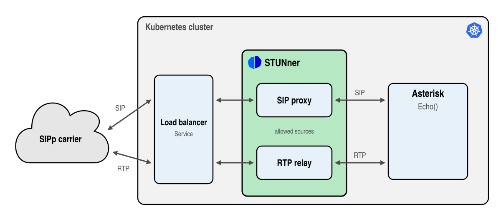

# A PBX behind a STUNner SIP Gateway

> [!WARNING]
> The SIP gateway is in beta: the API may change in any release and there is no support on any
> tier. Certain features require premium support: see [here](https://l7mp.io/pricing) for the
> limits and pricing.

This tutorial puts [Asterisk](https://www.asterisk.org), the most popular open-source PBX, behind a
STUNner SIP Gateway, the way a SIP trunk from a carrier reaches a PBX running in Kubernetes. The
carrier is played by [SIPp](https://sipp.sourceforge.net), the SIP traffic generator carriers and
SIP vendors test with: it calls Asterisk through STUNner and streams audio, and Asterisk answers
every call with an echo. Asterisk needs no host networking, no public address and no open RTP port
range: STUNner proxies the SIP and relays the RTP from a single public media port to the Asterisk
pod.



In this tutorial you will learn how to:
* configure Asterisk to take the calls of a SIP Gateway,
* make a STUNner Gateway a SIP gateway with a SIPTrunk and a UDPRoute to Asterisk,
* place calls with media through STUNner with SIPp, and read the call quality in Asterisk.

To see the SIP gateway work first with a single tool, try the [SIP echo
tutorial](../sip-echo/README.md).

## Prerequisites

* A STUNner installation from the official Helm chart, see the [installation
  guide](../../INSTALL.md).
* A load balancer that preserves the source address of the traffic it forwards
  (`externalTrafficPolicy: Local`): the managed load balancers of the large cloud providers do, and
  so does [MetalLB](https://metallb.io) on a local [kind](https://kind.sigs.k8s.io) cluster.
* A machine to run SIPp on whose address the cluster sees unchanged: a machine with a public IP
  address, or your own machine calling a local kind cluster. STUNner sends the media of a call to
  the address in the SDP of the caller, as carriers expect.
* [SIPp](https://sipp.sourceforge.net) 3.8 or newer (`sipp -v`; older versions end the call
  before the audio plays). Download the static Linux binary of the latest release, or install your
  distribution's package where it is new enough:

  ```console
  curl -sL -o sipp https://github.com/SIPp/sipp/releases/latest/download/sipp && sudo install sipp /usr/local/bin/
  ```

  or, where your distribution's package is 3.8 or newer, `sudo apt-get install sip-tester`.

## Configuration

1. Deploy Asterisk. The manifest holds its configuration in a ConfigMap, three short files that
   replace the samples of the image:

   ```console
   cd stunner
   kubectl apply -f docs/examples/sip-asterisk/asterisk.yaml
   ```

   `pjsip.conf` takes SIP on UDP port 5060 and handles every call with the endpoint named
   `anonymous`, which asks for no authentication: STUNner admits only the carrier, so Asterisk
   need not.

   ```ini
   [transport-udp]
   type=transport
   protocol=udp
   bind=0.0.0.0:5060

   [anonymous]
   type=endpoint
   transport=transport-udp
   context=echo
   disallow=all
   allow=alaw,ulaw
   ```

   `extensions.conf` answers the calls of the `echo` context and sends their audio back, and
   `rtp.conf` keeps the RTP of Asterisk on UDP ports 10000-10099 of the pod. Asterisk puts the
   address of its pod in its SDP, which is just what STUNner needs: no `external_media_address`,
   no NAT settings.

   ```ini
   [echo]
   exten => echo,1,Answer()
    same => n,Echo()
    same => n,Hangup()
   ```

1. Find the address your calls come from, as the cluster sees it: on a local kind cluster this
   is the address of your machine on the kind network (`docker network inspect kind`), otherwise
   your public address.

   ```console
   export MY_IP=$(curl -s -4 ifconfig.me)
   ```

1. Create the SIP Gateway:

   ```console
   kubectl create namespace stunner
   sed "s/MY_IP/${MY_IP}/" docs/examples/sip-asterisk/sip-gateway.yaml | kubectl apply -f -
   ```

   The manifest holds the GatewayClass and the GatewayConfig of the other tutorials and the three
   objects that make the SIP gateway. The Gateway has a SIP listener and a media listener, and
   names the SIPTrunk in `spec.infrastructure.parametersRef`, which makes it a SIP gateway; the
   `external-traffic-policy: local` annotation keeps the source addresses of the carrier intact.

   ```yaml
   apiVersion: gateway.networking.k8s.io/v1
   kind: Gateway
   metadata:
     name: sip-gateway
     namespace: stunner
     annotations:
       stunner.l7mp.io/external-traffic-policy: local
   spec:
     gatewayClassName: stunner-gatewayclass
     infrastructure:
       parametersRef:
         group: stunner.l7mp.io
         kind: SIPTrunk
         name: carrier
     listeners:
       - name: sip
         protocol: UDP
         port: 5060
       - name: media
         protocol: UDP
         port: 30000
   ```

   The SIPTrunk names the media listener, which carries the RTP of every call on the single
   public port 30000, and admits calls only from the carrier's addresses, yours here:

   ```yaml
   apiVersion: stunner.l7mp.io/v1alpha1
   kind: SIPTrunk
   metadata:
     name: carrier
     namespace: stunner
   spec:
     mediaListener: media
     allowedSources:
       - MY_IP
   ```

   Asterisk terminates both the SIP and the RTP, so a single UDPRoute with no `sectionName`
   attaches to both listeners: STUNner proxies the calls to Asterisk's port 5060 and relays their
   media to the Asterisk pod, at the port its SDP names.

   ```yaml
   apiVersion: stunner.l7mp.io/v1
   kind: UDPRoute
   metadata:
     name: asterisk
     namespace: stunner
   spec:
     parentRefs:
       - name: sip-gateway
     rules:
       - backendRefs:
           - name: asterisk
             namespace: default
             port: 5060
   ```

1. Check that the Gateway is programmed and keep its address:

   ```console
   kubectl -n stunner get gateway sip-gateway
   export GATEWAY_IP=$(kubectl -n stunner get gateway sip-gateway -o jsonpath='{.status.addresses[0].value}')
   ```

## Test

SIPp places the calls with [`sipp-call.xml`](sipp-call.xml): an INVITE offering G.711 A-law audio,
five seconds of a 1 kHz tone streamed over RTP from [`tone.wav`](tone.wav), and a BYE. Run it from
the tutorial's directory, so SIPp finds the audio file. `-i` binds SIPp to your address, which it
writes into its SIP messages and its SDP: STUNner sends the echoed audio back there.

```console
cd docs/examples/sip-asterisk
sipp -sf sipp-call.xml -s echo -m 1 -i ${MY_IP} -nostdin ${GATEWAY_IP}:5060
```

SIPp exits with status 0 when every call succeeded, and its statistics screen counts them:

```console
  Successful call        |        0                  |        1
  Failed call            |        0                  |        0
```

Then load Asterisk with 10 calls, 2 new calls per second, at most 5 at a time:

```console
sipp -sf sipp-call.xml -s echo -r 2 -l 5 -m 10 -i ${MY_IP} -nostdin ${GATEWAY_IP}:5060
```

While the calls run, Asterisk reports the quality of every call's media, the packets, the loss and
the jitter each way:

```console
kubectl exec deploy/asterisk -- asterisk -rx "pjsip show channelstats"
                                             ...........Receive......... .........Transmit..........
 BridgeId ChannelId ........ UpTime.. Codec.   Count    Lost Pct  Jitter   Count    Lost Pct  Jitter RTT....
 ===========================================================================================================

          anonymous-00000001 00:00:03 alaw      135       0    0   0.000    135       0    0   0.000   0.000
          anonymous-00000002 00:00:02 alaw      110       0    0   0.000    110       0    0   0.000   0.000
...
```

And STUNner counts the media it relayed on the media listener and to the Asterisk cluster:

```console
stunnerctl -n stunner status sip-gateway
```

## Troubleshooting

* **The calls get no answer.** The SIP listener admits only the addresses of `allowedSources`.
  Check that `MY_IP` is the address the cluster sees, and that the load balancer preserves it.
* **The calls connect but Asterisk counts nothing received.** STUNner relays the media to the
  address in SIPp's SDP: run SIPp with `-i` set to the address the cluster sees, from a machine
  that address reaches.
* **SIPp cannot open `tone.wav`.** Run SIPp from `docs/examples/sip-asterisk`. The file is five
  seconds of a 1 kHz tone in G.711 A-law, made with `ffmpeg -f lavfi -i sine=frequency=1000:duration=5
  -ar 8000 -ac 1 -c:a pcm_alaw tone.wav`.
* **The Gateway is not accepted.** The open-source operator supports no SIPTrunk: install the
  official STUNner chart. Each tier serves a limited number of SIP Gateways (see the [pricing](https://l7mp.io/pricing)).

## User quota (premium tiers)

A misconfigured trunk or a toll-fraud attack can flood the PBX with calls, and every call that gets
in eats its CPU and may cost you money. Model a burst, ten calls at once: all ten reach Asterisk.

```console
sipp -sf sipp-call.xml -s echo -r 10 -l 10 -m 10 -i ${MY_IP} -nostdin ${GATEWAY_IP}:5060
  Successful call        |        0                  |       10
  Failed call            |        0                  |        0
```

With a STUNner license, the [user quota](../../PREMIUM_REFERENCE.md#user-quota) caps the calls a SIP
Gateway admits at once, at the edge: the calls beyond the quota are refused before they reach the
PBX. Cap the calls at four and repeat the burst; the quota takes effect on the fly, with no
restart:

```console
kubectl -n stunner patch gatewayconfig stunner-gatewayconfig --type merge -p '{"spec":{"userQuota":4}}'
sipp -sf sipp-call.xml -s echo -r 10 -l 10 -m 10 -i ${MY_IP} -nostdin ${GATEWAY_IP}:5060
  Successful call        |        0                  |        4
  Failed call            |        0                  |        6
```

See the [pricing](https://l7mp.io/pricing) for the license tiers and the [premium installation
guide](../../PREMIUM_INSTALL.md) for setting up STUNner with a license.

## Clean up

```console
cd ../../..
kubectl delete -f docs/examples/sip-asterisk/asterisk.yaml
sed "s/MY_IP/${MY_IP}/" docs/examples/sip-asterisk/sip-gateway.yaml | kubectl delete -f -
kubectl delete namespace stunner
```
