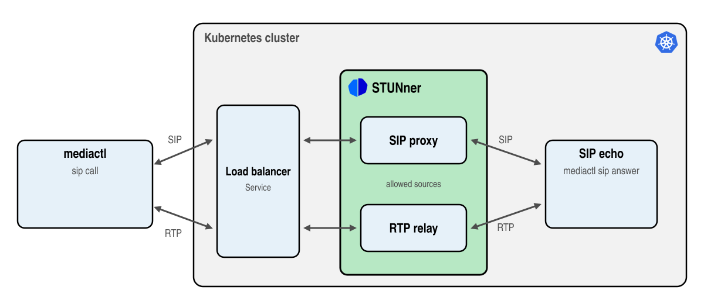

# Call a SIP echo service in Kubernetes

> [!WARNING]
> The SIP gateway is in beta: the API may change in any release and there is no support on any
> tier. Certain features require premium support: see [here](https://l7mp.io/pricing) for the
> limits and pricing.

This tutorial connects a SIP phone on your machine through a STUNner SIP Gateway to a SIP echo
service running in Kubernetes: STUNner proxies the SIP signaling and relays the RTP media, the
echo service answers the call and sends the media back, and [`mediactl`](../../cmd/mediactl.md) counts what comes
back. It is the smallest end-to-end test of the beta [SIP gateway](../../SIP.md), the
same path a carrier's calls take into your SIP server.



In this tutorial you will learn how to:
* deploy a SIP service into Kubernetes,
* make a STUNner Gateway a SIP gateway with a SIPTrunk,
* call the service through STUNner with the `mediactl` tool.

## Prerequisites

* A STUNner installation from the official Helm chart, see the [installation
  guide](../../INSTALL.md).
* A load balancer that preserves the source address of the traffic it forwards
  (`externalTrafficPolicy: Local`): the managed load balancers of the large cloud providers do, and
  so does [MetalLB](https://metallb.io) on a local [kind](https://kind.sigs.k8s.io) cluster.
* A machine to run `mediactl` on whose address the cluster sees unchanged: a machine with a
  public IP address, or your own machine calling a local kind cluster. STUNner matches the media
  of a call to the address in its SDP, so a phone behind a NAT that rewrites its source
  address gets no media back (carriers do not sit behind such NATs, which is why STUNner can rely
  on this).
* The `mediactl` tool, a media source and sink that also makes SIP calls: download it from the
  [STUNner releases](https://github.com/l7mp/stunner/releases) or install it with `go install
  github.com/l7mp/stunner/v2/cmd/mediactl@latest`.

## Configuration

1. Deploy the SIP echo service: the STUNner `mediactl` image, answering every
   call on UDP port 5060 and echoing the media.

   ```console
   cd stunner
   kubectl apply -f docs/examples/sip-echo/sip-echo-server.yaml
   ```

1. Find the address your calls come from, as the cluster sees it: on a local kind cluster this
   is the address of your machine on the kind network (`docker network inspect kind`), otherwise
   your public address (for instance `curl -4 ifconfig.me`).

   ```console
   export MY_IP=$(curl -s -4 ifconfig.me)
   ```

1. Create the SIP Gateway. The manifest holds the GatewayClass and the GatewayConfig of the other
   tutorials, a Gateway with a SIP listener on UDP port 5060 and a media listener on UDP port
   30000, a SIPTrunk that admits calls only from your address, and a UDPRoute to the echo service.
   The Gateway names the SIPTrunk in `spec.infrastructure.parametersRef`, which makes it a SIP
   gateway; the `stunner.l7mp.io/external-traffic-policy: local` annotation keeps the source
   addresses intact.

   ```console
   kubectl create namespace stunner
   sed "s/MY_IP/${MY_IP}/" docs/examples/sip-echo/sip-echo-stunner.yaml | kubectl apply -f -
   ```

1. Check that the Gateway is programmed and has a public address.

   ```console
   kubectl -n stunner get gateway sip-gateway
   ```

   The `PROGRAMMED` column should read `True` and `ADDRESS` should hold the load balancer address.
   A Gateway that is not accepted says why in its status: `kubectl -n stunner get gateway
   sip-gateway -o yaml`.

## Test

Call the echo service for ten seconds, letting `mediactl` find the address of the Gateway through
your kubeconfig, and rate the call as a voice call:

```console
mediactl sip call -t 10s --voip k8s://stunner/sip-gateway/sip
```

Without a kubeconfig, call the address of the Gateway: `mediactl sip call -t 10s
sip:echo@<address>:5060`.

`mediactl` sends G.711-sized audio packets for ten seconds, logs every second, and hangs up with a
summary:

```console
mediactl INFO: summary 9.9s, sent 496 pkts 79 kB 63.94 kbit/s, received 496 pkts 79 kB 63.94 kbit/s, lost 0/496 (0.00%), rtt min/avg/max 280µs/466µs/907µs, jitter 29µs, R-factor 93.0, MOS 4.40
```

No loss means the media made the round trip through STUNner. The loss, the round trip and the
jitter are the numbers VoIP quality is judged by, and `--voip` rates them with the ITU-T E-model as
a G.711 call: an R-factor above 80 and a MOS above 4 mean a good call, 4.4 is as good as G.711
gets. You can watch the call in the STUNner dataplane, while it runs:

```console
stunnerctl -n stunner status sip-gateway
```

## Troubleshooting

* **The call gets no answer.** The SIP listener admits only the addresses of `allowedSources`.
  Check that `MY_IP` is the address the cluster sees, and that the load balancer preserves it (the
  `stunner.l7mp.io/external-traffic-policy: local` annotation).
* **The call connects but `received` stays zero.** The media is matched to the address in the
  SDP of `mediactl`: a NAT on the way that rewrites the source address breaks the match. Run
  `mediactl` from a machine with a public address, or from the network of a local kind cluster.
* **The Gateway is not accepted.** The open-source operator supports no SIPTrunk: install the
  official STUNner chart. Each tier serves a limited number of SIP Gateways (see the [pricing](https://l7mp.io/pricing)); the oldest ones by creation time win.

## Kernel offload (premium tiers)

In production the dataplane shares its node with busy neighbors, and a traffic spike can leave it
short of CPU. Model this: give the Gateway a Dataplane of its own, squeezed to 20m CPU, and place
ten calls at once.

```console
kubectl apply -f docs/examples/sip-echo/sip-echo-dataplane.yaml
kubectl -n stunner patch gatewayconfig stunner-gatewayconfig --type merge -p '{"spec":{"dataplane":"sip-echo"}}'
mediactl sip call -P 10 -t 15s --voip k8s://stunner/sip-gateway/sip
mediactl INFO: total of 10 streams: 14.6s, ..., lost 5.9k/7.2k (82.16%), ..., jitter 230.953ms, R-factor -454.7, MOS 1.00
```

(The new Dataplane replaces the Gateway's pod: wait until `kubectl -n stunner get pods` shows a
single pod before calling.) The calls are unusable: the media waits in user space for the CPU. The
[kernel offload](../../PREMIUM_REFERENCE.md#kernel-offload) of STUNner relays the media in the Linux
kernel instead, and the free tier includes it, no license needed. Switch it on: the same pod with
the same 20m CPU, no restart, and the calls are as good as G.711 gets.

```console
kubectl patch dataplane sip-echo --type merge -p '{"spec":{"offloadEngine":"TC"}}'
mediactl sip call -P 10 -t 15s --voip k8s://stunner/sip-gateway/sip
mediactl INFO: total of 10 streams: 14.9s, ..., lost 0/7k (0.00%), ..., jitter 56µs, R-factor 92.8, MOS 4.40
```

The free tier offloads a limited number of flows per dataplane pod. A STUNner license offloads
many more and unlocks the [premium features](../../PREMIUM_REFERENCE.md): see the
[pricing](https://l7mp.io/pricing) and the [premium installation guide](../../PREMIUM_INSTALL.md).

## Clean up

```console
kubectl delete -f docs/examples/sip-echo/sip-echo-server.yaml
sed "s/MY_IP/${MY_IP}/" docs/examples/sip-echo/sip-echo-stunner.yaml | kubectl delete -f -
kubectl delete -f docs/examples/sip-echo/sip-echo-dataplane.yaml --ignore-not-found
kubectl delete namespace stunner
```
