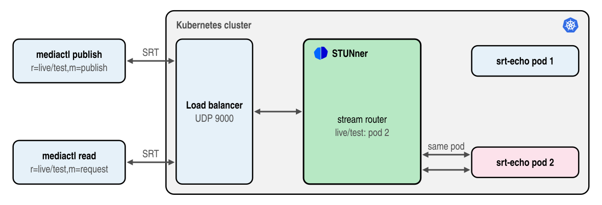

# Stream SRT through STUNner with mediactl

> [!WARNING]
> The SRT gateway is in beta: the API may change in any release and there is no support on any
> tier. Certain features require premium support: see [here](https://l7mp.io/pricing) for the
> limits and pricing.

This tutorial streams [SRT](https://github.com/Haivision/srt) through a STUNner SRT Gateway to an
SRT test service running in Kubernetes, two replicas of the STUNner
[`mediactl`](../../cmd/mediactl.md) tool, and measures the path with `mediactl`. It shows the job
of the gateway in its simplest form: an SRT publisher and SRT readers connect to one public UDP
port, and STUNner sends every connection of a stream to the pod that holds the stream, whichever
pod the load balancer would have picked. Again, a single public IP and a single port is exposed via
STUNner.



In this tutorial you will learn how to:
* make a STUNner Gateway an SRT gateway,
* echo, publish and read SRT streams through STUNner with the `mediactl` tool,
* see STUNner place a publisher and its reader on the same pod.

## Prerequisites

* A STUNner installation from the official Helm chart, see the [installation
  guide](../../INSTALL.md).
* The `mediactl` tool, a media source and sink that also speaks SRT: download it from the
  [STUNner releases](https://github.com/l7mp/stunner/releases) or install it with `go install
  github.com/l7mp/stunner/v2/cmd/mediactl@latest`.

SRT needs no special load balancer or network: any machine that reaches the cluster's load balancer
works.

## Configuration

1. Deploy the SRT test service: two replicas of the STUNner `mediactl` image, each passing the
   streams published to it to the readers of the same stream, and echoing every other SRT
   connection, encrypted with the passphrase `my-srt-passphrase`.

   ```console
   cd stunner
   kubectl apply -f docs/examples/srt-echo/srt-echo-server.yaml
   ```

1. Create the SRT Gateway:

   ```console
   kubectl create namespace stunner
   kubectl apply -f docs/examples/srt-echo/srt-gateway.yaml
   ```

   The manifest holds the GatewayClass and the GatewayConfig of the other tutorials, a Gateway
   with a listener of protocol `SRT`, which takes SRT callers on UDP port 9000, and a UDPRoute to
   the test service: STUNner reads the stream ID of every SRT handshake and connects the caller to
   the pod of the Service that holds the stream.

   ```yaml
   apiVersion: gateway.networking.k8s.io/v1
   kind: Gateway
   metadata:
     name: srt-gateway
     namespace: stunner
   spec:
     gatewayClassName: stunner-gatewayclass
     listeners:
       - name: srt
         protocol: SRT
         port: 9000
   ---
   apiVersion: stunner.l7mp.io/v1
   kind: UDPRoute
   metadata:
     name: srt-echo
     namespace: stunner
   spec:
     parentRefs:
       - name: srt-gateway
     rules:
       - backendRefs:
           - name: srt-echo
             namespace: default
             port: 8890
   ```

1. Check that the Gateway is programmed:

   ```console
   kubectl -n stunner get gateway srt-gateway
   ```

## Test

Echo a stream for ten seconds, letting `mediactl` find the address of the Gateway through your
kubeconfig:

```console
mediactl srt send -t 10s k8s://stunner/srt-gateway live/echo --passphrase my-srt-passphrase
```

`mediactl` sends packets on the stream `live/echo`, the test service sends them back, and
`mediactl` logs every second and a summary at the end:

```console
...
mediactl INFO: summary ..., lost 0/497 (0.00%), rtt min/avg/max 246.106ms/250.163ms/251.063ms, ...
```

No loss means the stream made the round trip through STUNner. The round trip includes the latency
buffer of SRT's live mode, which delivers every packet 120 ms after it was sent by default, on both
ends: 250 ms is SRT, not the network.

Then publish a stream and read it on another connection. Start the reader first, in one terminal,
since a reader that joins late counts the packets sent before it joined as lost:

```console
mediactl srt read -t 20s k8s://stunner/srt-gateway live/test --passphrase my-srt-passphrase
```

and the publisher in another one:

```console
mediactl srt publish -t 10s k8s://stunner/srt-gateway live/test --passphrase my-srt-passphrase
```

The reader receives what the publisher sends with no loss. This works only because both connections
reach the same pod of the test service, which the logs show:

```console
kubectl logs -l app=srt-echo --prefix | grep live/test
[pod/srt-echo-5f4cfc9d9b-gq8qn/srt-echo] ... request on stream "live/test"
[pod/srt-echo-5f4cfc9d9b-gq8qn/srt-echo] ... publish on stream "live/test"
```

You can watch the connections in the STUNner dataplane while they run:

```console
stunnerctl -n stunner status srt-gateway
```

If in trouble, try the below:

* **The connection is rejected.** STUNner rejects a stream ID that names no stream, a stream with
  no backend, and a stream over the parallel sessions of your tier, in the handshake (see the [pricing](https://l7mp.io/pricing)).
* **The handshake times out.** The passphrase is checked by the test service, not by STUNner: use
  `my-srt-passphrase` on both ends.
* **The Gateway is not accepted.** The open-source operator renders no SRT server: install the
  official STUNner chart. Each tier serves a limited number of SRT Gateways.

## User quota (premium tiers)

A misconfigured encoder fleet, or a single encoder reconnecting under ever new stream names, can
open more streams than the media servers can take. Model four encoders, each one publishing a
stream.

```console
for s in a b c d; do (mediactl srt send -t 5s -l all:WARN k8s://stunner/srt-gateway live/$s \
    --passphrase my-srt-passphrase >/dev/null 2>&1 && echo "live/$s admitted" || echo "live/$s refused") & done; wait
live/a admitted
live/b admitted
live/c admitted
live/d admitted
```

STUNner implements a [user quota](../../PREMIUM_REFERENCE.md#user-quota) feature to cap the streams
an SRT Gateway admits at once. Streams beyond the quota are refused in the SRT handshake with a
clean rejection message before they reach the media servers. Every connection of an admitted
stream, its publisher and all its readers, counts as the one stream. Cap the streams at two and
repeat:

```console
kubectl -n stunner patch gatewayconfig stunner-gatewayconfig --type merge -p '{"spec":{"userQuota":2}}'
for s in a b c d; do (mediactl srt send -t 5s -l all:WARN k8s://stunner/srt-gateway live/$s \
    --passphrase my-srt-passphrase >/dev/null 2>&1 && echo "live/$s admitted" || echo "live/$s refused") & done; wait
live/a refused
live/b admitted
live/c admitted
live/d refused
```

See the [pricing](https://l7mp.io/pricing) for the license tiers and the [premium installation
guide](../../PREMIUM_INSTALL.md) for setting up STUNner with a license.

## Clean up

```console
kubectl delete -f docs/examples/srt-echo/srt-echo-server.yaml
kubectl delete -f docs/examples/srt-echo/srt-gateway.yaml
kubectl delete namespace stunner
```
