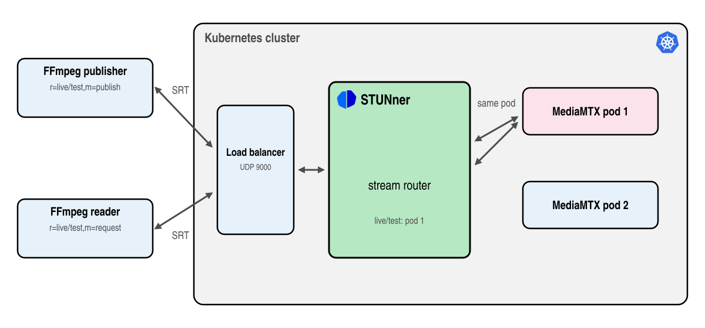

# Stream SRT video into MediaMTX

> [!WARNING]
> The SRT gateway is in beta: the API may change in any release and there is no support on any
> tier. Certain features require premium support: see [here](https://l7mp.io/pricing) for the
> limits and pricing.

This tutorial streams [SRT](https://github.com/Haivision/srt) video through a STUNner SRT Gateway
into [MediaMTX](https://github.com/bluenviron/mediamtx), a popular open-source media server,
running in two replicas in Kubernetes. An [FFmpeg](https://ffmpeg.org) publisher sends a test video
and FFmpeg readers watch it. STUNner accepts connections on a single public IP address and port and
sends the publisher and the readers of a stream to the same MediaMTX pod. This allows to scale out
the media server replicas without host networking or a Service per pod.



In this tutorial you will learn how to:
* deploy MediaMTX into Kubernetes behind a STUNner SRT Gateway,
* publish and read SRT video through STUNner with FFmpeg,
* see STUNner place the streams over the MediaMTX replicas.

To see the SRT gateway work first with a single tool, try the [SRT echo
tutorial](../srt-echo/README.md).

## Prerequisites

* A STUNner installation from the official Helm chart, see the [installation
  guide](../../INSTALL.md).
* [FFmpeg](https://ffmpeg.org) built with SRT support: `ffmpeg -protocols` lists `srt`, as the
  packages of the Linux distributions do.

SRT needs no special load balancer or network: any machine that reaches the cluster's load balancer
works.

## Configuration

1. Deploy MediaMTX: two replicas taking SRT on UDP port 8890, accepting any stream encrypted with
   the passphrase `my-srt-passphrase`, set through MediaMTX's environment variables.

   ```console
   cd stunner
   kubectl apply -f docs/examples/srt-mediamtx/mediamtx.yaml
   ```

1. Create the SRT Gateway, a Gateway with a listener of protocol `SRT` on UDP port 9000 and a
   UDPRoute to MediaMTX, next to the GatewayClass and the GatewayConfig of the other tutorials:

   ```console
   kubectl create namespace stunner
   kubectl apply -f docs/examples/srt-mediamtx/srt-gateway.yaml
   ```

   ```yaml
   apiVersion: gateway.networking.k8s.io/v1
   kind: Gateway
   metadata:
     name: srt-gateway
     namespace: stunner
   spec:
     gatewayClassName: stunner-gatewayclass
     listeners:
       - name: srt
         protocol: SRT
         port: 9000
   ---
   apiVersion: stunner.l7mp.io/v1
   kind: UDPRoute
   metadata:
     name: mediamtx
     namespace: stunner
   spec:
     parentRefs:
       - name: srt-gateway
     rules:
       - backendRefs:
           - name: mediamtx
             namespace: default
             port: 8890
   ```

1. Check that the Gateway is programmed and keep its address:

   ```console
   kubectl -n stunner get gateway srt-gateway
   export SRT_IP=$(kubectl -n stunner get gateway srt-gateway -o jsonpath='{.status.addresses[0].value}')
   ```

## Test

Publish a test video, a test pattern with a tone, encoded with H.264 (a keyframe every two seconds,
so that a reader can start decoding soon after it joins) and AAC in MPEG-TS, as the stream
`live/test`. The stream ID `#!::r=live/test,m=publish` names the stream and the mode, as SRT's
access control convention has it; STUNner routes by the stream, MediaMTX checks the passphrase.

```console
ffmpeg -re -f lavfi -i testsrc=size=1280x720:rate=30 -f lavfi -i sine -c:v libx264 -preset veryfast -g 60 \
    -c:a aac -f mpegts "srt://${SRT_IP}:9000?streamid=#!::r=live/test,m=publish&passphrase=my-srt-passphrase"
```

Read it back in another terminal, without a screen: FFmpeg decodes the stream, discards the frames
and reports its progress every five seconds.

```console
ffmpeg -nostats -progress pipe:1 -stats_period 5 \
    -i "srt://${SRT_IP}:9000?streamid=#!::r=live/test,m=request&passphrase=my-srt-passphrase" -f null - \
    | grep -E '^(frame|out_time|speed)='
```

```console
frame=233
out_time=00:00:10.379320
speed=2.08x
frame=383
out_time=00:00:15.255488
speed=1.53x
...
```

An `out_time` advancing five seconds in every report and a `speed` settling toward `1x` mean that
the video arrives intact and in real time; the first reports run ahead while the reader catches up
with what MediaMTX had buffered. With a screen, watch the stream with `ffplay`, VLC or OBS:

```console
ffplay "srt://${SRT_IP}:9000?streamid=#!::r=live/test,m=request&passphrase=my-srt-passphrase"
```

The publisher and the reader reach the same MediaMTX pod. Publish a second stream with the same
FFmpeg command under another name, `live/test2`, and it lands on the other pod, the one with fewer
streams. The MediaMTX logs show
where each stream went:

```console
kubectl logs -l app=mediamtx --prefix | grep "is publishing"
[pod/mediamtx-69dddf99bc-qngdx/mediamtx] ... [SRT] [conn 10.244.0.17:45155] is publishing to path 'live/test'
[pod/mediamtx-69dddf99bc-xwsmb/mediamtx] ... [SRT] [conn 10.244.0.17:42951] is publishing to path 'live/test2'
```

If in trouble, try the below:

* **The connection is rejected.** STUNner rejects a stream ID that names no stream, a stream with
  no backend, and a stream over the parallel sessions of your tier, in the handshake (see the [pricing](https://l7mp.io/pricing)). Check that the stream ID uses the `#!::r=<stream>`
  syntax.
* **The handshake times out.** MediaMTX checks the passphrase, not STUNner: a wrong passphrase
  fails the handshake. Use `my-srt-passphrase` on both ends.
* **The reader is rejected.** MediaMTX rejects a reader of a stream nobody publishes: start the
  publisher first, and name the same stream on both ends.
* **The reader reports nothing for a while.** A reader can decode only from a keyframe on: keep the
  `-g 60` of the publisher, a keyframe every two seconds.
* **FFmpeg logs `incoming UMSG: 6 INVALID SIZE: 0`.** The SRT library of FFmpeg flags the empty
  ACKACK control packets of MediaMTX's SRT library; the stream is not affected.
* **The Gateway is not accepted.** The open-source operator renders no SRT server: install the
  official STUNner chart. Each tier serves a limited number of SRT Gateways.

## Kernel offload (premium tiers)

A live full HD feed at 10 Mbit/s is heavy work for a dataplane that shares its node with busy
neighbors. Model a dataplane short of CPU: give the Gateway a Dataplane of its own, squeezed to 20m
CPU, and publish 1080p video at 10 Mbit/s.

```console
kubectl apply -f docs/examples/srt-mediamtx/srt-mediamtx-dataplane.yaml
kubectl -n stunner patch gatewayconfig stunner-gatewayconfig --type merge -p '{"spec":{"dataplane":"srt-mediamtx"}}'
ffmpeg -re -f lavfi -i testsrc=size=1920x1080:rate=30 -f lavfi -i sine -c:v libx264 -preset ultrafast \
    -b:v 10M -maxrate 10M -bufsize 2M -g 60 -c:a aac -f mpegts \
    "srt://${SRT_IP}:9000?streamid=#!::r=live/test,m=publish&passphrase=my-srt-passphrase"
```

(The new Dataplane replaces the Gateway's pod: wait until `kubectl -n stunner get pods` shows a
single pod before publishing.) Count the frames a reader cannot decode in 20 seconds, the
artifacts and frozen pictures a viewer would see:

```console
timeout 20 ffmpeg -i "srt://${SRT_IP}:9000?streamid=#!::r=live/test,m=request&passphrase=my-srt-passphrase" \
    -f null - 2>&1 | grep -c "corrupt decoded frame"
7
```

The packets wait in user space for the CPU and miss the latency budget of SRT. The [kernel
offload](../../PREMIUM_REFERENCE.md#kernel-offload) of STUNner relays the streams in the Linux kernel
instead, and the free tier includes it, no license needed. Stop the publisher, switch on the
offload (the same pod with the same 20m CPU, no restart), publish again with the FFmpeg command
above and count again:

```console
kubectl patch dataplane srt-mediamtx --type merge -p '{"spec":{"offloadEngine":"TC"}}'
timeout 20 ffmpeg -i "srt://${SRT_IP}:9000?streamid=#!::r=live/test,m=request&passphrase=my-srt-passphrase" \
    -f null - 2>&1 | grep -c "corrupt decoded frame"
0
```

The free tier offloads a limited number of flows per dataplane pod. A STUNner license offloads
many more and unlocks the [premium features](../../PREMIUM_REFERENCE.md): see the
[pricing](https://l7mp.io/pricing) and the [premium installation guide](../../PREMIUM_INSTALL.md).

## Clean up

```console
kubectl delete -f docs/examples/srt-mediamtx/srt-gateway.yaml
kubectl delete -f docs/examples/srt-mediamtx/mediamtx.yaml
kubectl delete -f docs/examples/srt-mediamtx/srt-mediamtx-dataplane.yaml --ignore-not-found
kubectl delete namespace stunner
```
