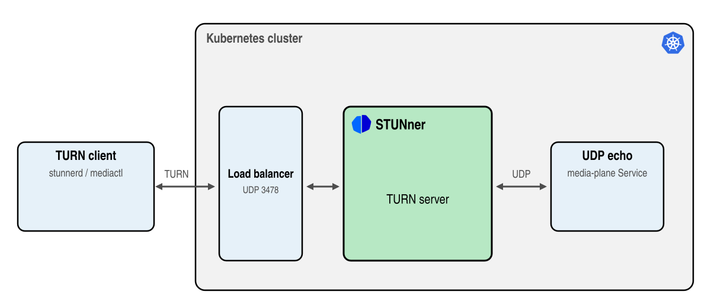

# Deploy a UDP echo service behind STUNner

> [!WARNING]
> Certain features require premium support: see [here](https://l7mp.io/pricing) for limits and
> pricing.

This tutorial exposes a UDP service running in Kubernetes to clients outside the cluster through a
STUNner TURN Gateway, and connects to it with a TURN client from your machine. It introduces the
main concepts of STUNner along the way, so it is also the quickest way to check a STUNner
installation.



In this tutorial you will learn how to:
* configure STUNner with the Gateway API to expose a UDP service to clients,
* connect to the service through STUNner with the [tunnel mode of
  `stunnerd`](../../cmd/stunnerd.md#tunnel-mode),
* measure the path with [`mediactl`](../../cmd/mediactl.md),
* add a TURN-TLS listener to an existing configuration.

## Prerequisites

* A STUNner installation, see the [installation guide](../../INSTALL.md).
* The `stunnerd`, `stunnerctl` and `mediactl` tools: download them from the [STUNner
  releases](https://github.com/l7mp/stunner/releases) or install them with `go install
  github.com/l7mp/stunner/v2/cmd/<tool>@latest`.

## Configuration

STUNner is configured through the Kubernetes [Gateway API](https://gateway-api.sigs.k8s.io), like
any Kubernetes workload: you declare what you want in YAML and apply it with `kubectl`, the [STUNner
gateway operator](https://github.com/l7mp/stunner-gateway-operator) creates the STUNner dataplane
(the `stunnerd` pods that run the TURN servers) and keeps it in sync with the configuration. We keep
the STUNner configuration in the `stunner` namespace:

```console
kubectl create namespace stunner
```

1. Register STUNner with the Gateway API by creating a GatewayClass, the [root of the STUNner
   configuration](../../GATEWAYCLASS.md#gatewayclass). Its `controllerName` hands the Gateways of
   the class to STUNner, and its `parametersRef` names the GatewayConfig with the settings of
   STUNner.

   ```console
   kubectl apply -f - <<EOF
   apiVersion: gateway.networking.k8s.io/v1
   kind: GatewayClass
   metadata:
     name: stunner-gatewayclass
   spec:
     controllerName: "stunner.l7mp.io/gateway-operator"
     parametersRef:
       group: "stunner.l7mp.io"
       kind: GatewayConfig
       name: stunner-gatewayconfig
       namespace: stunner
     description: "STUNner is a WebRTC media gateway for Kubernetes"
   EOF
   ```

1. Create the GatewayConfig with the [general settings](../../GATEWAYCLASS.md#gatewayconfig) of
   STUNner, most importantly the [TURN credentials](../../AUTH.md): the realm `stunner.l7mp.io`, and
   the credentials kept in the Secret `stunner-auth-secret`, the [`static`
   authentication](../../AUTH.md) with the username `user-1` and the password `pass-1`.

   ```console
   kubectl apply -f - <<EOF
   apiVersion: stunner.l7mp.io/v1
   kind: GatewayConfig
   metadata:
     name: stunner-gatewayconfig
     namespace: stunner
   spec:
     realm: stunner.l7mp.io
     authRef:
       name: stunner-auth-secret
       namespace: stunner
   ---
   apiVersion: v1
   kind: Secret
   metadata:
     name: stunner-auth-secret
     namespace: stunner
   type: Opaque
   stringData:
     type: static
     username: user-1
     password: pass-1
   EOF
   ```

   The GatewayClass and the GatewayConfig are needed only once per STUNner installation: every
   Gateway of the class shares them.

1. Expose STUNner to the clients with a [Gateway](../../GATEWAY.md#gateway): the one below opens a
   TURN listener on UDP port 3478. STUNner starts a TURN server for it and exposes it on a public
   address through a LoadBalancer Service; clients that authenticate with the credentials above may
   then reach the backends the routes of the Gateway name.

   ```console
   kubectl apply -f - <<EOF
   apiVersion: gateway.networking.k8s.io/v1
   kind: Gateway
   metadata:
     name: udp-gateway
     namespace: stunner
   spec:
     gatewayClassName: stunner-gatewayclass
     listeners:
       - name: udp-listener
         port: 3478
         protocol: TURN-UDP
   EOF
   ```

1. Tell STUNner where to send the client connections with a [UDPRoute](../../ROUTE.md#udproute):
   the one below attaches to the Gateway (`parentRefs`) and lets the clients reach the pods of the
   `media-plane` Service in the `default` namespace (`backendRefs`).

   ```console
   kubectl apply -f - <<EOF
   apiVersion: stunner.l7mp.io/v1
   kind: UDPRoute
   metadata:
     name: media-plane
     namespace: stunner
   spec:
     parentRefs:
       - name: udp-gateway
     rules:
       - backendRefs:
           - name: media-plane
             namespace: default
   EOF
   ```

   STUNner treats backend Services differently from Kubernetes: WebRTC media servers open a port
   per client, so STUNner lets the clients reach the backend pods at *any* port, not only at the
   ports of the Service. A single Service and a single UDPRoute thus cover every port of a media
   server.

1. Deploy the backend: `mediactl udp echo`, which sends back every packet it receives, in the
   `default` namespace, behind the `media-plane` Service on UDP port 9001. The Service is of type
   `ClusterIP`, unreachable from outside the cluster: the only way in is through STUNner.

   ```console
   kubectl apply -f https://raw.githubusercontent.com/l7mp/stunner/refs/heads/main/docs/examples/udp-echo/udp-echo.yaml
   ```

1. Check that the Gateway got a public address. It takes up to a minute for a cloud load balancer
   to assign one. Check the Services of the Gateways: `kubectl -n stunner get services`.

## Check your config

[`stunnerctl`](../../cmd/stunnerctl.md) shows the configuration STUNner runs for a Gateway:

```console
stunnerctl -n stunner config udp-gateway
Gateway: stunner/udp-gateway (loglevel: "all:INFO")
Authentication default: static, username/password: user-1/pass-1
Listeners:
  - Name: stunner/udp-gateway/udp-listener
    Protocol: UDP
    Server: stunner/udp-gateway/udp-listener (TURN)
    Address:port: <none>:3478
    Public address:port: 34.118.88.91:3478
    Clusters: [stunner/media-plane/udp]
    Endpoints: [10.76.1.4]
```

STUNner has received a public address for the Gateway, the credentials of the GatewayConfig and the
pod address of the echo service.

## Test

Clients reach the echo service through STUNner with a TURN client. The [tunnel mode of
`stunnerd`](../../cmd/stunnerd.md#tunnel-mode) is one: the command below relays the standard input
through the TURN listener to the echo service, so type a line and press Enter, and it comes back
from your cluster.

```console
stunnerd - k8s://stunner/udp-gateway/udp-listener k8s://default/media-plane:media-plane-port
Hello STUNner
Hello STUNner
```

No IP address or credential is needed: `k8s://stunner/udp-gateway/udp-listener` names the TURN
listener `udp-listener` of the Gateway `udp-gateway` in the `stunner` namespace, and
`k8s://default/media-plane:media-plane-port` the `media-plane` Service in the `default` namespace
at its port `media-plane-port`; `stunnerd` reads the addresses and the credentials from your cluster
through your kubeconfig.

To measure the path, let `mediactl` send packets through STUNner the same way for ten seconds and
report the loss and the round trip of the echo:

```console
mediactl turn send -t 10s k8s://stunner/udp-gateway/udp-listener k8s://default/media-plane:media-plane-port
...
mediactl INFO: summary ..., lost 0/500 (0.00%), rtt min/avg/max ...
```

Your WebRTC clients need no tunnel: every browser and WebRTC client has a TURN client built in. The
tunnel only does what they do.

## Add a TLS listener

You can change the configuration any time, and STUNner reconciles the dataplane to it. Say, an
enterprise firewall on the way of your clients lets nothing but TLS on port 443 through: add a
TURN-TLS Gateway, and attach the UDPRoute to both Gateways, so that the clients reach the echo
service whichever transport they use.

1. Store a TLS certificate in a Secret. Below is a self-signed one for testing; use a valid
   certificate in production.

   ```console
   openssl req -x509 -newkey rsa:2048 -nodes -days 365 -keyout tls.key -out tls.crt -subj "/CN=stunner.example.com"
   kubectl -n stunner create secret tls tls-secret --key tls.key --cert tls.crt
   ```

1. Add the TURN-TLS Gateway: its listener names the Secret in `tls.certificateRefs`.

   ```console
   kubectl apply -f - <<EOF
   apiVersion: gateway.networking.k8s.io/v1
   kind: Gateway
   metadata:
     name: tls-gateway
     namespace: stunner
   spec:
     gatewayClassName: stunner-gatewayclass
     listeners:
       - name: tls-listener
         port: 443
         protocol: TURN-TLS
         tls:
           mode: Terminate
           certificateRefs:
             - kind: Secret
               namespace: stunner
               name: tls-secret
   EOF
   ```

1. Attach the UDPRoute to both Gateways.

   ```console
   kubectl apply -f - <<EOF
   apiVersion: stunner.l7mp.io/v1
   kind: UDPRoute
   metadata:
     name: media-plane
     namespace: stunner
   spec:
     parentRefs:
       - name: udp-gateway
       - name: tls-gateway
     rules:
       - backendRefs:
           - name: media-plane
             namespace: default
   EOF
   ```

1. Tunnel through the TLS listener this time. `--insecure` accepts the self-signed certificate; a
   valid certificate needs no such flag.

   ```console
   stunnerd --insecure - k8s://stunner/tls-gateway/tls-listener k8s://default/media-plane:media-plane-port
   Hello STUNner
   Hello STUNner
   ```

   STUNner takes the TURN connection over TLS and relays it to the UDP echo service: the conversion
   between TLS and UDP happens in STUNner.

## Post-quantum TLS (premium tiers)

Data recorded today may be decrypted tomorrow: a large enough quantum computer would break the key
exchange of today's TLS. Regulators have start to require post-quantum encryption for sensitive
traffic. Out of the box, a STUNner TLS listener admits any client, even ones using insecure
classical key exchange protocols.

```console
export TLS_IP=$(kubectl -n stunner get gateway tls-gateway -o jsonpath='{.status.addresses[0].value}')
openssl s_client -connect ${TLS_IP}:443 -groups X25519 < /dev/null 2>&1 | grep -E "^Server Temp Key|handshake failure"
Server Temp Key: X25519, 253 bits
```

STUNner offers [post-quantum TLS](../../PREMIUM_REFERENCE.md#post-quantum-tls) to enforce a key
exchange quantum computers cannot break. There are two settings:
`stunner.l7mp.io/pqc-mode=preferred` will prefer a quantum-safe key exchange protocol during TLS
handshake but otherwise admits clients using a classical TLS client, while
`stunner.l7mp.io/pqc-mode=enforced` refuses classical TLS clients all together.

```console
kubectl -n stunner annotate --overwrite gateway tls-gateway stunner.l7mp.io/pqc-mode=enforced
openssl s_client -connect ${TLS_IP}:443 -groups X25519 < /dev/null 2>&1 | grep -E "^Server Temp Key|handshake failure"
... handshake failure ...
stunnerd --insecure - k8s://stunner/tls-gateway/tls-listener k8s://default/media-plane:media-plane-port
Hello STUNner
Hello STUNner
```

See the [pricing](https://l7mp.io/pricing) for the license tiers and the [premium installation
guide](../../PREMIUM_INSTALL.md) for setting up STUNner with a license.

## Clean up

Stop the tunnel and remove everything the tutorial created:

```console
kubectl delete -f https://raw.githubusercontent.com/l7mp/stunner/refs/heads/main/docs/examples/udp-echo/udp-echo.yaml
kubectl -n stunner delete udproute.stunner.l7mp.io media-plane
kubectl -n stunner delete gateway udp-gateway tls-gateway
kubectl -n stunner delete gatewayconfig stunner-gatewayconfig
kubectl -n stunner delete secret stunner-auth-secret tls-secret
kubectl delete gatewayclass stunner-gatewayclass
kubectl delete namespace stunner
rm -f tls.key tls.crt
```

The dataplane shuts down gracefully, serving its live TURN sessions to the end, so deleting the
namespace may take a while: a session whose client went away without releasing it ends when it
times out, within ten minutes.
